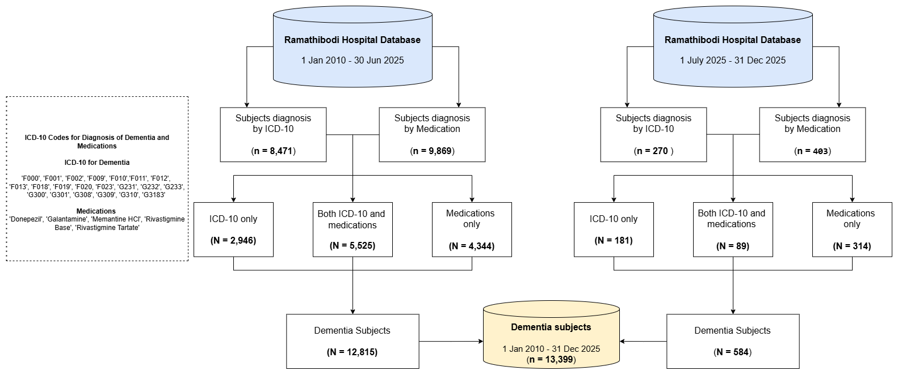
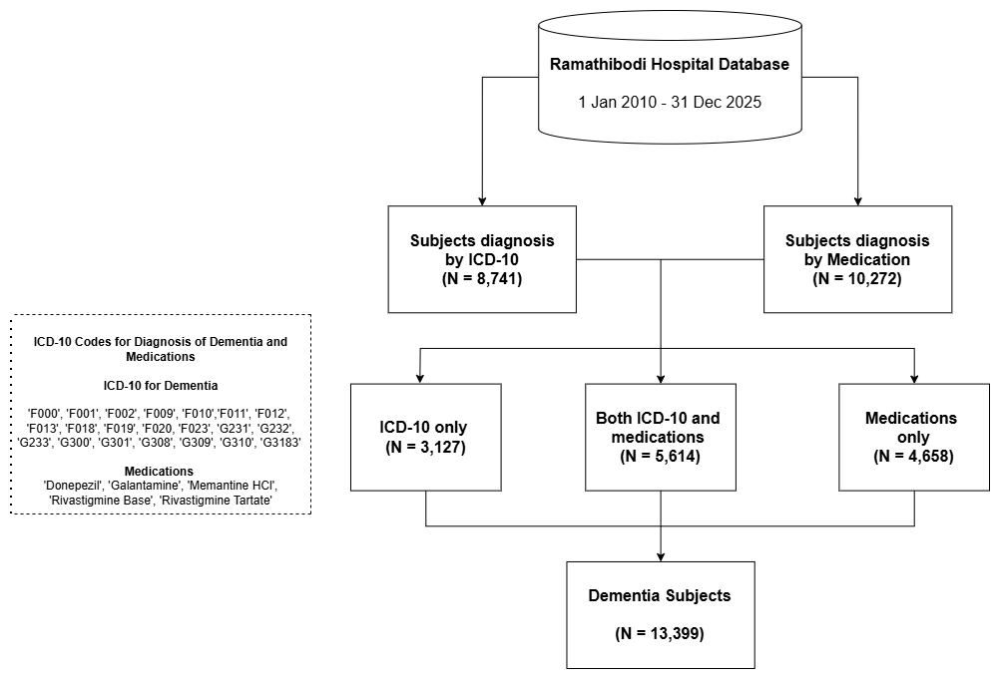

# Dementia Data Warehouse

- **Author:** Htun Teza
- **Date:** 29 October 2026

## Contents
- [Dementia Data Warehouse](#dementia-data-warehouse)
  - [Contents](#contents)
  - [Dementia Data Warehouse](#dementia-data-warehouse-1)
  - [Dementia cohort update](#dementia-cohort-update)
---

## Dementia Data Warehouse

### 2010-2026/06 (16.5 years)

Documentation on cohort identification procedure can be found [here](cohort_identification.md).

#### Data Flow

---

## Dementia cohort update

### Data Warehouse Timeline

#### ETL timeline

With our latest data extraction (ETL) in June 2026,

- New case update to June 2026 (Bi-Annually)
- Follow up visits update to June 2026 (Quarterly).

<!-- ### Update Summary

#### Cohort Update

 -->

<!-- #### Dementia Cohort (16 years)

 -->

#### Subtypes

From the 2010-2026/06 cohort, patients are classified with the v2 subtype labels: FTD, PDD, PSP and MSA are separate subtypes, and Unspecified is split into Unspecified (ICD) and Unspecified (med). As mentioned in cohort identification documentation, patients can be classified by either index diagnosis or final diagnosis. The flowchart above groups patients by final diagnosis. The subtype distribution at index and at final, and the transitions between them, can be found [here](cohort_identification.md#subtype-distribution).

### Supplementary

#### Code

The example code used in CEB data warehouse can be found in the code folder.

|Type|Usage|Link|
|---|---|---|
|Cohort identification|Example code for cohort identification, subtype labels (v2), wide and long outputs|[here](code/cohort_identification.py)|
|Settings|Data delivery, study window and output folder used by the example code|[here](code/update_config.py)|

#### Maplist

The maplist of ICD-10 codes and medication codes used for cohort identification can be found in the maplist folder. 

| Type | Usage | Link |
| --- | --- | --- |
| Dementia (ICD-10) | Cohort identification and subtype labels (`subtype_detail` column) | [here](maplist/cohort/dementia_icd10_map.csv) |
| Medication (Intrahospital Code) | Cohort identification | [here](maplist/cohort/medication_map.csv) |
| | | |
| MCI (ICD-10) | Exclusion criteria for AChEI | [here](maplist/cohort/mci_icd10_map.csv) |
| Schizophrenia (ICD-10) | Exclusion criteria for Memantine | [here](maplist/cohort/schizophrenia_icd10_map.csv) |
| Clozazpine (Intrahospital Code) | Exclusion criteria for Memantine | [here](maplist/cohort/clozapine_map.csv) |
| Radiotherapy (ICD-9) | Exclusion criteria for Memantine | [here](maplist/cohort/radiotherapy_icd9_map.csv) |
| | | |
| MCI (ICD-10) | Codes under review | [here](maplist/cohort/review_code_map.csv) |
| BPSD (ICD-10) | Codes under review | [here](maplist/cohort/review_code_map.csv) |
| Degenerative / Uncertain (ICD-10) | Codes under review | [here](maplist/cohort/review_code_map.csv) |

#### Data Request
More details regarding this and other cohorts can be found [here](https://www.rama.mahidol.ac.th/ceb/CEBdatawarehouse/Data/Dementia) at CEB-RAMA-MU. Data request can be made on the same webpage.