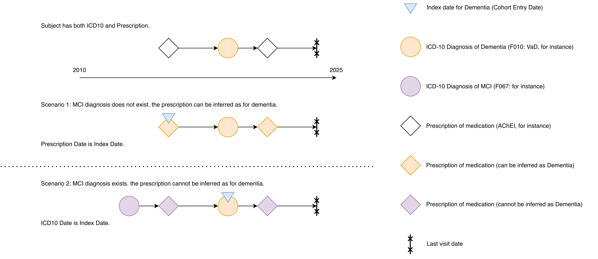
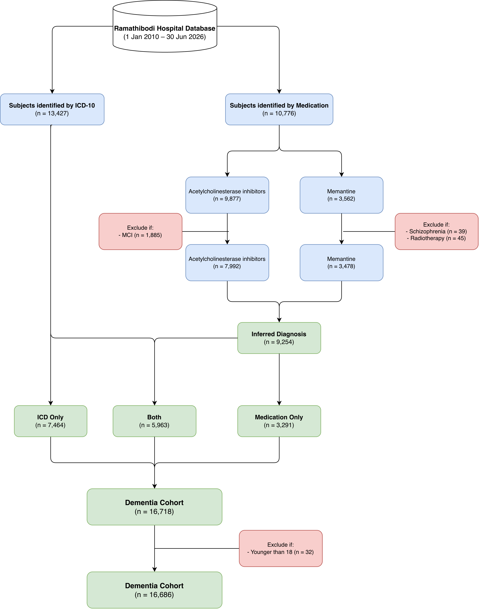

# Dementia Cohort Identification

- **Author:** Htun Teza
- **Date:** 29 October 2026

> [!IMPORTANT]
> Please be aware that the information provided here is current as of the date of this documentation. However, it is subject to potential changes or updates in the future.

> [!NOTE]
> From the 2010-2026/06 cohort, the **v2 subtype labels** are the standard labels. Frontotemporal Dementia (FTD), Parkinson's Disease Dementia (PDD), Progressive Supranuclear Palsy (PSP) and Multiple System Atrophy (MSA) are separate subtypes, and Unspecified Dementia is split into **Unspecified (ICD)** and **Unspecified (med)**. The 2010-2025/12 cohort used the v1 labels (AD, VaD, Other, Mixed, Unspecified).

## Contents

- [Dementia Cohort Identification](#dementia-cohort-identification)
  - [Contents](#contents)
  - [Data Source](#data-source)
  - [Loosely Defined Criteria](#loosely-defined-criteria)
  - [Exactly Defined Criteria](#exactly-defined-criteria)
  - [Subtype Classification](#subtype-classification)
  - [Final Cohort](#final-cohort)
  - [Subtype Distribution](#subtype-distribution)

---

## Data Source

This cohort was retrieved from the Ramathibodi Hospital Information System covering **1 January 2010 to 30 June 2026**, processed as of 29 October 2026. The data warehouse was developed by the Data Science and Clinical Informatics Division, Department of Clinical Epidemiology and Biostatistics, Faculty of Medicine Ramathibodi Hospital, Mahidol University.

Medication records come from the prescription orders (order and CPOE tables). All dates are recorded at the day level.

---

## Loosely Defined Criteria

Patients were identified using two parallel criteria applied with an **OR condition** — meeting either criterion was sufficient for inclusion.

### Diagnosis of Dementia

Patients were identified from clinic and in-patient visit records using ICD-10-TM diagnostic codes. The following codes were used:

| ICD-10-TM Code | Dementia Subtype | Label |
|:---|:---|:---|
| F000, F001, F002, F009 | Alzheimer's Disease | AD |
| G300, G301, G308, G309 | Alzheimer's Disease | AD |
| F010, F011, F012, F013, F018, F019 | Vascular Dementia | VaD |
| F020, G310 | Frontotemporal Dementia | FTD |
| F023 | Parkinson's Disease Dementia | PDD |
| G231 | Progressive Supranuclear Palsy | PSP |
| G232, G233 | Multiple System Atrophy | MSA |
| G318 | Other Specified Degenerative Dementia | Other |
| F021, F022, F024, F028 | Other Dementia (CJD, Huntington's, HIV, other) | Other |
| F03 | Unspecified Dementia | Unspecified (ICD) |

The mapping table of ICD-10-TM codes to dementia subtypes can be found in the maplist folder [here](maplist/cohort/dementia_icd10_map.csv). The `subtype_detail` column holds the label above.

> [!NOTE]
> Dementia with Lewy Bodies (DLB) does not have a dedicated ICD-10-TM code. In clinical practice at Ramathibodi Hospital, DLB cases are coded under **G318** (Other Specified Degenerative Diseases of the Nervous System), which is a broader category not exclusive to DLB. As a result, G318 cannot be reliably mapped to DLB as a distinct subtype and is therefore classified under **Other Dementia** in this cohort.

### Prescription of Anti-Dementia Medications

Patients prescribed any of the following anti-dementia medications were included, regardless of whether a formal dementia diagnosis was recorded.

| Medication | Drug Class |
|:---|:---|
| Donepezil | Acetylcholinesterase inhibitor |
| Rivastigmine | Acetylcholinesterase inhibitor |
| Galantamine | Acetylcholinesterase inhibitor |
| Memantine HCl | NMDA receptor antagonist |

The mapping table of medication codes to drug names can be found in the maplist folder [here](maplist/cohort/medication_map.csv).

> [!IMPORTANT]
> This criterion identifies patients by prescription only, with no exclusion rules applied at this stage. Exclusion rules are applied in the [Exactly Defined Criteria](#exactly-defined-criteria) section, where the remaining medication-only patients are labelled as **Unspecified (med)**. Patients with F03 and no specific subtype are labelled as **Unspecified (ICD)**. The two labels have the same meaning (no specific subtype yet) and show the source of the evidence.

### Merging for Tentative Cohort

Utilizing these dual inclusion criteria — diagnosis codes and medication prescriptions — allowed us to categorize patients into three distinct groups based on their dementia status:

1. Patients with ICD-10 dementia codes only (*n* = 6385)
2. Patients with both ICD-10 dementia codes and anti-dementia medication prescriptions (*n* = 7042)
3. Patients with anti-dementia medication prescriptions only (*n* = 3734)

Groups 1 and 2 are considered to have a confirmed diagnosis of dementia. However, the prescription records undergo further review under the [Exactly Defined Criteria](#exactly-defined-criteria) to determine eligibility for inclusion as **Unspecified (med)** dementia. The index date for all groups is determined after exclusion rules are applied.

---

## Exactly Defined Criteria

### Inferred Diagnosis of Dementia

Patients prescribed anti-dementia medications require further review before a dementia diagnosis can be inferred from medication records alone. The aim is to exclude medication prescriptions that may plausibly be explained by alternative diagnoses or indications, thereby refining the medication-based identification arm to patients with a reasonable inferred diagnosis of dementia.

Importantly, these exclusion rules are applied to determine whether medication use can be interpreted as evidence of dementia. They do not necessarily remove the patient from the overall dementia cohort if the patient also has a qualifying ICD-10 dementia diagnosis.

#### Scenario 1: Both ICD-10 and Medication

For patients with both ICD-10 dementia codes and anti-dementia medication prescriptions, the presence of alternative diagnoses means that the medication record cannot used to infer dementia. In these cases, the patient is retained through the ICD-10 diagnosis pathway, and the earliest qualifying ICD-10 dementia date is used as the index date.

#### Scenario 2: Only Medication

For patients with only anti-dementia medication prescriptions and no corresponding ICD-10 dementia code, the presence of alternative diagnoses means that dementia cannot be inferred from medication alone. Therefore, exclusion rules are applied to remove such cases from the medication-only inferred dementia group.

The medication arm is split into two groups — **AChEI** (Donepezil, Rivastigmine, Galantamine) and **Memantine** — which are assessed separately against their respective exclusion criteria. Patients may appear in both groups if prescribed both drug classes. After exclusions, the remaining patients from both groups are merged into the **Unspecified (med)** dementia group.

#### AChEI Group

Patients with any AChEI prescription are excluded from the dementia cohort if an **MCI diagnosis exists anywhere in their medical history**, as AChEI is also indicated for MCI. The reasonable inferred diagnosis for such patients is MCI rather than dementia.

| Exclusion Rule | Criterion |
|:---|:---|
| MCI differential | MCI diagnosis (F067, R41, R418) present anywhere in patient's medical history |

The mapping table of MCI-related ICD-10-TM codes can be found in the maplist folder [here](maplist/cohort/mci_icd10_map.csv).

#### Memantine Group

Patients with any Memantine prescription are assessed against two exclusion criteria, as Memantine has indications beyond dementia.

| Exclusion Rule | Criterion |
|:---|:---|
| Schizophrenia differential | Clozapine prescription **or** schizophrenia-related diagnosis present anywhere in patient's medical history |
| Radiotherapy differential | Memantine prescription falls within the course of radiotherapy (between first and last recorded radiotherapy date) |

The mapping table of schizophrenia-related ICD-10-TM codes can be found in the maplist folder [here](maplist/cohort/schizophrenia_icd10_map.csv). The mapping table of clozapine medication codes can be found [here](maplist/cohort/clozapine_map.csv). The mapping table of radiotherapy-related ICD-9-CM procedure codes can be found [here](maplist/cohort/radiotherapy_icd9_map.csv).

##### Radiotherapy

The course of radiotherapy is identified using the following ICD-9-CM procedure codes:

| ICD-9-CM Code | Description |
|:---|:---|
| 9221 | Superficial radiation |
| 9222 | Orthovoltage radiation |
| 9223 | Radioisotope teleradiotherapy |
| 9224 | Teleradiotherapy using photons |
| 9225 | Teleradiotherapy using electrons |
| 9226 | Teleradiotherapy using other particles |
| 9227 | Implantation or insertion of radioactive elements |
| 9229 | Other radiotherapy |
| 9230 | Stereotactic radiosurgery, NOS |
| 9231 | Single source photon radiosurgery |
| 9232 | Multi-source photon radiosurgery (Gamma Knife) |
| 9233 | Particulate radiosurgery |
| 9239 | Stereotactic radiosurgery, NEC |
| 9241 | Intraoperative electron radiation therapy |

> [!NOTE]
> At this stage, any Memantine prescription recorded during a course of radiotherapy — regardless of the body site irradiated — is excluded from consideration as a dementia indicator. It is noted that the approach may overestimate however it allows the exclusion criteriato be standardized across centers.

#### Merging into Inferred Diagnosis

Patients who pass all applicable exclusion criteria — from either or both the AChEI and Memantine groups — are labelled **Unspecified (med)**. This label is kept separate from **Unspecified (ICD)** (ICD-10 code F03), as described in the [Subtype Classification](#subtype-classification) section.

### Merging for Final Cohort

Following the application of exclusion criteria to the medication arm, patients are consolidated into three groups:

1. Patients with ICD-10 dementia codes only (*n* = 7464)
2. Patients with both ICD-10 dementia codes and qualifying anti-dementia medication prescriptions (*n* = 5963)
3. Patients with qualifying anti-dementia medication prescriptions only — **Unspecified (med)** (*n* = 3291)

All three groups are included in the final dementia cohort.

### Data Format

This table serves as the primary table for cohort curation. For each patient, the following dates are recorded:

- **Diagnosis date** — the earliest date of any qualifying ICD-10 dementia code, including unspecified (F03) and subtype-specific codes
- **Subtype-specific date** — the earliest date of each subtype-specific ICD-10 code (AD, VaD, FTD, PDD, PSP, MSA, Other, Unspecified (ICD))
- **Medication date** — the earliest date of any qualifying anti-dementia medication prescription, after exclusion criteria have been applied

The **index date** is defined as the earlier of the diagnosis date and the medication date.

#### Example Data Table

| HN | Index Date | Diagnosis Date | Medication Date | AD Date | VaD Date | FTD Date | PDD Date | PSP Date | MSA Date | Other Date | Unspecified (ICD) Date |
|-|-|-|-|-|-|-|-|-|-|-|-|
| 001 | 2016-08-24 | 2016-08-24 | 2016-08-24 | 2016-08-24 | — | — | — | — | — | — | — |
| 002 | 2022-10-17 | 2022-10-17 | — | — | — | — | — | — | 2022-10-17 | — | — |
| 003 | 2023-02-02 | — | 2023-02-02 | — | — | — | — | — | — | — | — |
| 004 | 2010-03-06 | 2012-09-01 | 2010-03-06 | — | 2012-09-01 | — | — | — | — | — | — |
| 005 | 2018-05-10 | 2019-03-01 | 2018-05-10 | — | — | — | — | — | — | — | 2019-03-01 |
| 006 | 2014-11-03 | 2017-06-15 | 2014-11-03 | 2017-06-15 | — | — | — | — | — | — | 2017-06-15 |
| 007 | 2012-09-12 | 2012-09-12 | — | 2012-09-12 | — | — | — | — | — | 2015-04-20 | — |
| 008 | 2019-11-28 | 2022-04-18 | 2019-11-28 | — | — | — | — | 2022-04-18 | — | 2022-04-18 | 2023-12-02 |

> [!NOTE]
> **Unspecified (ICD) Date** refers specifically to the earliest date of an ICD-10-TM F03 diagnosis code recorded in the patient's history. It does not reflect the medication date, which is captured separately in the **Medication Date** column. Patients identified solely through medication prescription without an F03 code will have a blank Unspecified (ICD) Date regardless of their subtype label.

#### Long Format

A second table has one row per patient and subtype. Each row records the date on which a subtype first appears (`dx`) and the label of the patient on that date (`label`). The label uses all the evidence on or before that date.

| Column | Description |
|:---|:---|
| `ENC_HN` | Patient identifier |
| `date` | First date of the subtype in `dx` |
| `dx` | Subtype that first appears on `date`: AD, VaD, FTD, PDD, PSP, MSA, Other, Unspecified (ICD), Unspecified (med) |
| `label` | Label of the patient on `date` |
| `first_code` | ICD-10-TM code or medication code on `date` |
| `source` | `dx` (diagnosis) or `med` (qualifying medication) |

For HN 008 in the example data table above:

| HN | date | dx | label | first_code | source |
|-|-|-|-|-|-|
| 008 | 2019-11-28 | Unspecified (med) | Unspecified (med) | EXEL1X | med |
| 008 | 2022-04-18 | PSP | Mixed | G231 | dx |
| 008 | 2022-04-18 | Other | Mixed | G318 | dx |
| 008 | 2023-12-02 | Unspecified (ICD) | Mixed | F030 | dx |

The last label of a patient in the long table is the final label, and the label on the index date is the initial label.

---

## Subtype Classification

Each patient is assigned two subtype labels: an **initial label** based on information available at the index date, and a **final label** based on the patient's complete longitudinal record.

### Dementia Subtypes

| Subtype | Classification Basis |
|:---|:---|
| Alzheimer's Disease (AD) | ICD-10-TM codes: F000, F001, F002, F009, G300, G301, G308, G309 |
| Vascular Dementia (VaD) | ICD-10-TM codes: F010, F011, F012, F013, F018, F019 |
| Frontotemporal Dementia (FTD) | ICD-10-TM codes: F020, G310 |
| Parkinson's Disease Dementia (PDD) | ICD-10-TM code: F023 |
| Progressive Supranuclear Palsy (PSP) | ICD-10-TM code: G231 |
| Multiple System Atrophy (MSA) | ICD-10-TM codes: G232, G233 |
| Other Dementia | ICD-10-TM codes: G318, F021, F022, F024, F028 |
| Mixed Dementia | Coexistence of two or more **specific** subtypes (AD, VaD, FTD, PDD, PSP, MSA, or Other) recorded in the same individual |
| Unspecified (ICD) | ICD-10-TM code F03 without any specific subtype ICD-10 code |
| Unspecified (med) | Prescription of anti-dementia medication without any ICD-10 dementia code |

Two codes of the same subtype do not make Mixed Dementia (for example, G318 and F028 are both Other). Codes of two different specific subtypes on the same day make Mixed Dementia (for example, AD and VaD). A specific subtype on the same day as F03 or medication takes precedence (for example, AD and medication on the same day give AD).

### Initial Label

The initial label is assigned at the **index date** using only the information present at that point in time.

- **Diagnosis only** → subtype is derived directly from the ICD-10 code(s) present at index
- **Medication only** → labelled as Unspecified (med)
- **Both diagnosis and medication** → subtype is derived from the ICD-10 code(s); medication confirms the clinical picture but does not change the subtype assignment

If multiple specific subtype ICD-10 codes from different subtypes are present at the index date, the patient is labelled **Mixed Dementia**. If a specific subtype code co-occurs with F03 or medication only, the specific subtype takes precedence and the patient is **not** labelled Mixed.

### Final Label

The final label is assigned after reviewing the patient's **complete longitudinal record**. This allows subtype refinement over time — most notably, patients initially labelled Unspecified (ICD) or Unspecified (med) may later accrue a specific ICD-10 diagnosis, resolving them into a specific subtype or Mixed.

The final label follows the same logic as the initial label but applied across the full observation window:

- A patient who accumulates specific subtype codes from more than one subtype at any point → **Mixed Dementia**
- A specific subtype code co-occurring with F03 or medication only → specific subtype takes precedence, **not** Mixed
- A medication-only patient who never receives an ICD-10 dementia code → remains **Unspecified (med)**
- A medication-only patient who later receives an F03 code only → reclassified to **Unspecified (ICD)**
- A medication-only patient who later receives a specific ICD-10 code → reclassified to that subtype (or Mixed if multiple specific subtypes)

A label never returns to an earlier state: Mixed remains Mixed, and a specific subtype never returns to Unspecified.

#### Example Data Table (Labelled)

**Referring to the [example data table](#example-data-table) above,** the initial and final labels are determined as follows:

- HN 001 had an AD diagnosis at index (2016) and was also prescribed medication on the same day → initial label is AD, final label remains AD.
- HN 002 had an MSA diagnosis at index (2022); no other diagnosis came later → initial label is MSA, final label remains MSA.
- HN 003 remained medication-only throughout → Unspecified (med) at both time points.
- HN 004 was identified first by medication (2010); a VaD diagnosis came later (2012) → initial label is Unspecified (med), final label resolves to VaD.
- HN 005 was identified first by medication (2018); an F03 diagnosis came later (2019) → initial label is Unspecified (med), final label is Unspecified (ICD).
- HN 006 was identified first by medication (2014); an AD diagnosis and F03 code arrived together (2017) → final label is AD, not Mixed, as the specific subtype takes precedence over Unspecified.
- HN 007 had an AD diagnosis at index (2012) and later accrued an Other subtype diagnosis (2015) → final label becomes Mixed.
- HN 008 was identified first by medication (2019); PSP and Other diagnoses arrived on the same day (2022) → final label becomes Mixed.

| HN | Index Date | Initial Label | Final Label |
|-|-|-|-|
| 001 | 2016-08-24 | Both / AD | Both / AD |
| 002 | 2022-10-17 | Diagnosis / MSA | Diagnosis / MSA |
| 003 | 2023-02-02 | Medication / Unspecified (med) | Medication / Unspecified (med) |
| 004 | 2010-03-06 | Medication / Unspecified (med) | Both / VaD |
| 005 | 2018-05-10 | Medication / Unspecified (med) | Both / Unspecified (ICD) |
| 006 | 2014-11-03 | Medication / Unspecified (med) | Both / AD |
| 007 | 2012-09-12 | Diagnosis / AD | Diagnosis / Mixed |
| 008 | 2019-11-28 | Medication / Unspecified (med) | Both / Mixed |

---

## Final Cohort

All patients meeting either inclusion criterion are included in the **CEB Data Warehouse – Dementia Theme**. Only adult patients aged **18 years or older** on the index date are included. The cohort covers the period from **1 January 2010 to 30 June 2026** (*n* = 16686).

Dataflow in xml format (Draw.io) can be found [here](images/format/flow_diagram.drawio).

---

## Subtype Distribution

> [!NOTE]
> The following tables are based on data identified up to 30 June 2026, and may not reflect any subsequent data additions or corrections.

### Distribution

The table below shows the number of patients (*n*) and percentage (%) by subtype at index date and at final observation.

| Subtype                        | Index n (%)     | Final n (%)     |
|--------------------------------|-----------------|-----------------|
| Alzheimer's Disease            | 3596 (21.55%)   | 5223 (31.30%)   |
| Vascular Dementia              | 1074 (6.44%)    | 1391 (8.34%)    |
| Frontotemporal Dementia        | 23 (0.14%)      | 24 (0.14%)      |
| Parkinson's Disease Dementia   | 201 (1.20%)     | 252 (1.51%)     |
| Progressive Supranuclear Palsy | 73 (0.44%)      | 76 (0.46%)      |
| Multiple System Atrophy        | 83 (0.50%)      | 81 (0.49%)      |
| Other Dementia                 | 1451 (8.70%)    | 1415 (8.48%)    |
| Mixed Dementia                 | 142 (0.85%)     | 2213 (13.26%)   |
| Unspecified (ICD)              | 3740 (22.41%)   | 2722 (16.31%)   |
| Unspecified (med)              | 6303 (37.77%)   | 3289 (19.71%)   |
| Total                          | 16686 (100.00%) | 16686 (100.00%) |

### Transitions

The table below shows how initial subtype labels transition to final subtype labels. Rows are index subtypes; columns are final subtypes. Values are *n* (%).

| Index \ Final     |   Row Total | AD            | VaD          | FTD         | PDD          | PSP         | MSA         | Other         | Mixed         | Unspecified (ICD)   | Unspecified (med)   |
|-------------------|-------------|---------------|--------------|-------------|--------------|-------------|-------------|---------------|---------------|---------------------|---------------------|
| AD                |        3596 | 3034 (84.37%) | 0 (0.00%)    | 0 (0.00%)   | 0 (0.00%)    | 0 (0.00%)   | 0 (0.00%)   | 0 (0.00%)     | 562 (15.63%)  | 0 (0.00%)           | 0 (0.00%)           |
| VaD               |        1074 | 0 (0.00%)     | 806 (75.05%) | 0 (0.00%)   | 0 (0.00%)    | 0 (0.00%)   | 0 (0.00%)   | 0 (0.00%)     | 268 (24.95%)  | 0 (0.00%)           | 0 (0.00%)           |
| FTD               |          23 | 0 (0.00%)     | 0 (0.00%)    | 18 (78.26%) | 0 (0.00%)    | 0 (0.00%)   | 0 (0.00%)   | 0 (0.00%)     | 5 (21.74%)    | 0 (0.00%)           | 0 (0.00%)           |
| PDD               |         201 | 0 (0.00%)     | 0 (0.00%)    | 0 (0.00%)   | 152 (75.62%) | 0 (0.00%)   | 0 (0.00%)   | 0 (0.00%)     | 49 (24.38%)   | 0 (0.00%)           | 0 (0.00%)           |
| PSP               |          73 | 0 (0.00%)     | 0 (0.00%)    | 0 (0.00%)   | 0 (0.00%)    | 65 (89.04%) | 0 (0.00%)   | 0 (0.00%)     | 8 (10.96%)    | 0 (0.00%)           | 0 (0.00%)           |
| MSA               |          83 | 0 (0.00%)     | 0 (0.00%)    | 0 (0.00%)   | 0 (0.00%)    | 0 (0.00%)   | 76 (91.57%) | 0 (0.00%)     | 7 (8.43%)     | 0 (0.00%)           | 0 (0.00%)           |
| Other             |        1451 | 0 (0.00%)     | 0 (0.00%)    | 0 (0.00%)   | 0 (0.00%)    | 0 (0.00%)   | 0 (0.00%)   | 1375 (94.76%) | 76 (5.24%)    | 0 (0.00%)           | 0 (0.00%)           |
| Mixed             |         142 | 0 (0.00%)     | 0 (0.00%)    | 0 (0.00%)   | 0 (0.00%)    | 0 (0.00%)   | 0 (0.00%)   | 0 (0.00%)     | 142 (100.00%) | 0 (0.00%)           | 0 (0.00%)           |
| Unspecified (ICD) |        3740 | 688 (18.40%)  | 222 (5.94%)  | 0 (0.00%)   | 39 (1.04%)   | 4 (0.11%)   | 1 (0.03%)   | 18 (0.48%)    | 418 (11.18%)  | 2350 (62.83%)       | 0 (0.00%)           |
| Unspecified (med) |        6303 | 1501 (23.81%) | 363 (5.76%)  | 6 (0.10%)   | 61 (0.97%)   | 7 (0.11%)   | 4 (0.06%)   | 22 (0.35%)    | 678 (10.76%)  | 372 (5.90%)         | 3289 (52.18%)       |
| Column Total      |       16686 | 5223          | 1391         | 24          | 252          | 76          | 81          | 1415          | 2213          | 2722                | 3289                |
